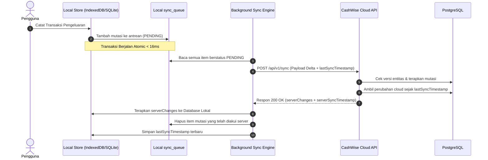

# Strategi Protokol Sinkronisasi Hybrid CashWise (SYNC_STRATEGY.md)

Dokumen ini menguraikan protokol komprehensif untuk pertukaran data dua arah (*Bidirectional Delta Sync*) antara penyimpanan lokal (IndexedDB di Web dan SQLite di Mobile) dengan database Cloud (PostgreSQL).

---

## 1. Arsitektur "Local-First" & Antrean Mutasi (`sync_queue`)

Pada fase saat ini, aplikasi Web dan Mobile beroperasi **sepenuhnya secara lokal (Local Storage First)**:
1. Setiap operasi pembuatan, pengubahan, atau penghapusan data langsung disimpan ke penyimpanan lokal perangkat:
   - **Web:** IndexedDB (`cashwise_local_db`).
   - **Mobile Flutter:** SQLite (`cashwise.db` via `sqflite`).
2. Setiap mutasi lokal dicatat secara atomik ke tabel pendukung lokal: `sync_queue`.
3. Format item antrean `sync_queue`:
   ```typescript
   interface SyncQueueItem {
     id?: number;              // Auto-increment integer (lokal)
     entityType: 'user' | 'account' | 'category' | 'transaction' | 'budget';
     entityId: string;         // UUID v4
     action: 'CREATE' | 'UPDATE' | 'DELETE';
     payload: string;          // JSON snapshot data
     createdAt: string;        // ISO 8601 timestamp
     status: 'PENDING' | 'SYNCING' | 'FAILED';
     retryCount: number;
   }
   ```
4. Karena seluruh entitas menggunakan **UUID v4** yang digenerate di sisi client, pembuatan data baru tidak memerlukan komunikasi ke server untuk mendapatkan Primary Key.

---

## 2. Siklus Eksekusi Sinkronisasi (Sync Lifecycle)

Ketika sinkronisasi cloud diaktifkan di masa mendatang, client akan menjalankan tahapan berikut:



---

## 3. Resolusi Konflik (Conflict Resolution: LWW with Audit)

Ketika dua perangkat (misalnya Ponsel dan Laptop) mengedit transaksi yang sama saat kedua-duanya sedang *offline*, konflik versi akan terdeteksi di server:

1. **Deteksi Konflik:**
   - Server membandingkan `clientVersion` dengan `serverVersion` saat ini.
   - Jika `serverVersion > clientVersion`, maka entitas telah dimodifikasi oleh perangkat lain sebelumnya.

2. **Resolusi Last-Write-Wins (LWW):**
   - Server membandingkan milidetik timestamp `updatedAt` dari mutasi client dengan `updatedAt` yang ada di database cloud.
   - Perubahan dengan `updatedAt` paling mutakhir menang (*Last-Write-Wins*).
   - Seluruh mutasi lama dan informasi perangkat dicatat di tabel `sync_audit_log` di cloud, sehingga data historis tidak akan hilang.

3. **Penanganan Penghapusan (Tombstone):**
   - Penghapusan data tidak menggunakan `DELETE FROM`, melainkan mengisi kolom `deletedAt = ISO_TIMESTAMP`.
   - Hal ini memastikan bahwa status penghapusan dapat dikirimkan (*propagated*) ke perangkat lain yang baru menyala setelah masa offline lama.
   - Retensi tombstone di server disimpan selama minimal 30 hari sebelum dibersihkan permanen oleh background worker (*vacuum/garbage collection*).
