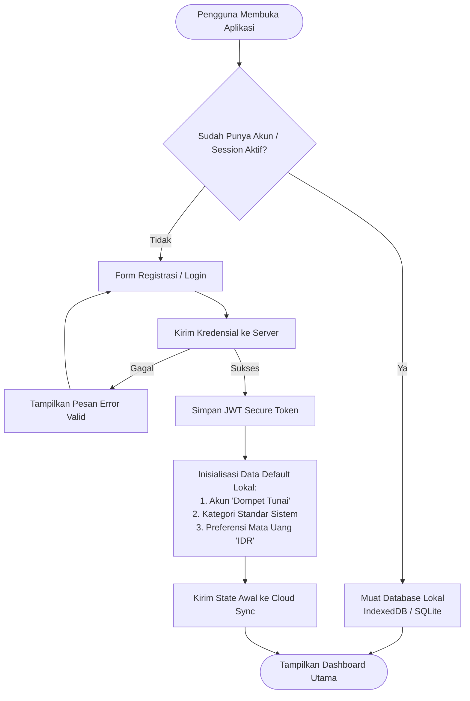
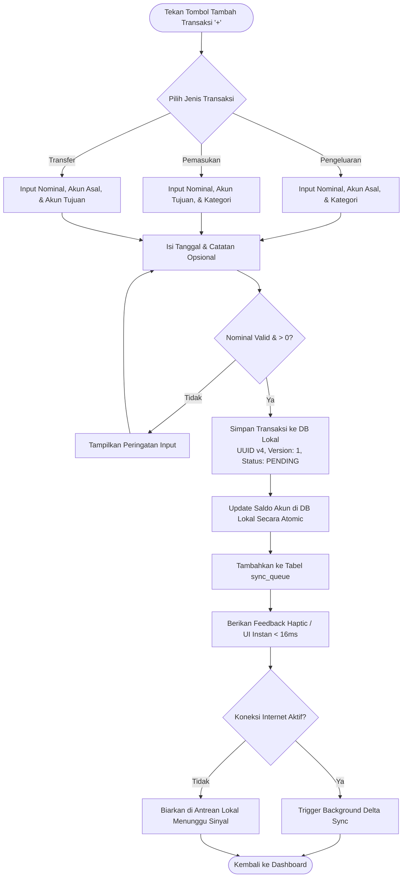
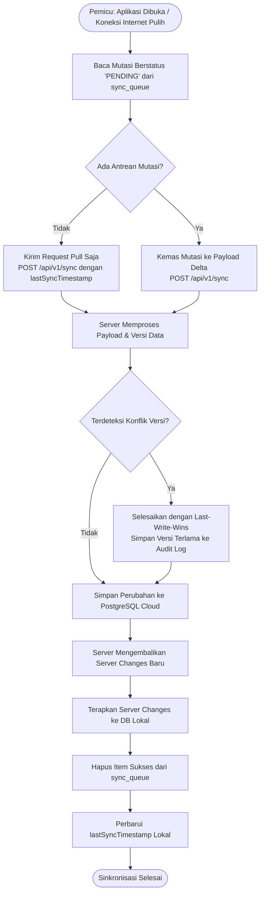
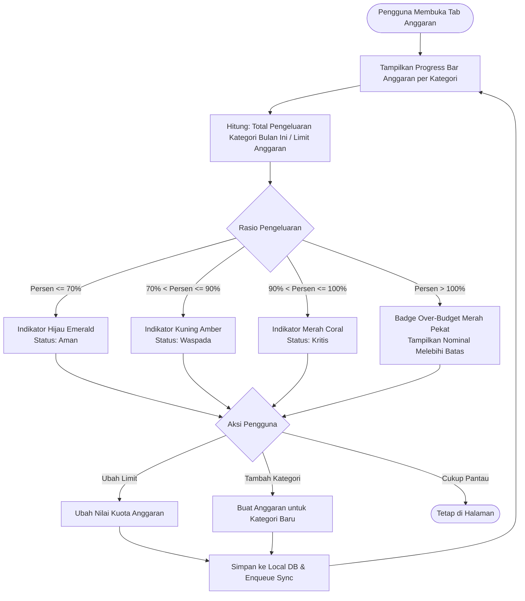
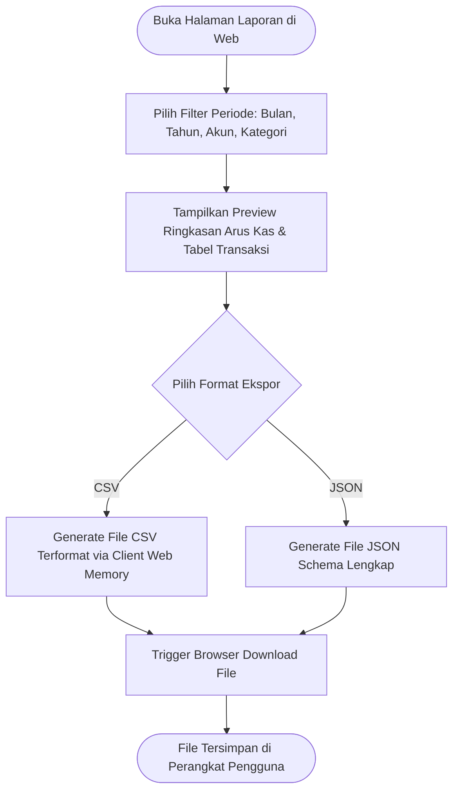

# Diagram Alur Pengguna (USER_FLOW.md) — CashWise

Dokumen ini merinci diagram alur pengguna (*User Flows*) untuk interaksi utama di Web dan Mobile, disajikan dalam diagram Mermaid yang terstruktur dan mudah diuji.

---

## 1. Alur Registrasi, Onboarding & Inisialisasi Akun

Alur pertama kali pengguna baru membuka CashWise. Sistem membuatkan akun default dan kategori dasar secara otomatis di database lokal sebelum menyinkronkannya ke cloud.

---

## 2. Alur Pencatatan Transaksi Kilat (Online & Offline)

Alur pencatatan harian yang mengutamakan kecepatan respon. Dirancang agar dapat diselesaikan dalam < 3 detik tanpa ketergantungan jaringan.

---

## 3. Alur Sinkronisasi Latar Belakang & Resolusi Konflik

Mekanisme sinkronisasi otomatis yang berjalan saat koneksi pulih, saat aplikasi dibuka (*app resume*), atau saat interval polling berkala.

---

## 4. Alur Penganggaran & Pemantauan Batas Pengeluaran

Alur penetapan batas anggaran dan peringatan otomatis ketika pengeluaran mendekati kuota maksimal.

---

## 5. Alur Ekspor Laporan Keuangan (Web Application)

Alur pengguna mengekspor rekapan transaksi dan ringkasan bulanan dari antarmuka Web.

